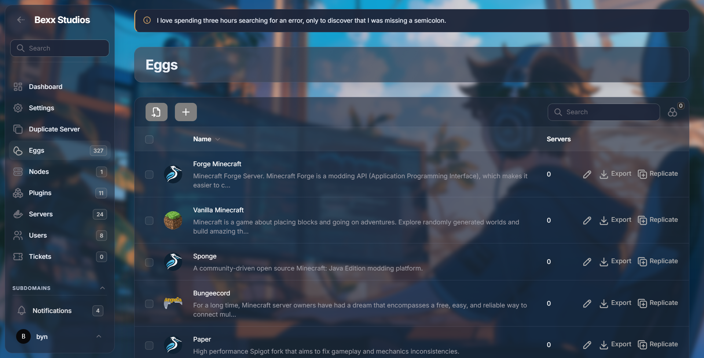
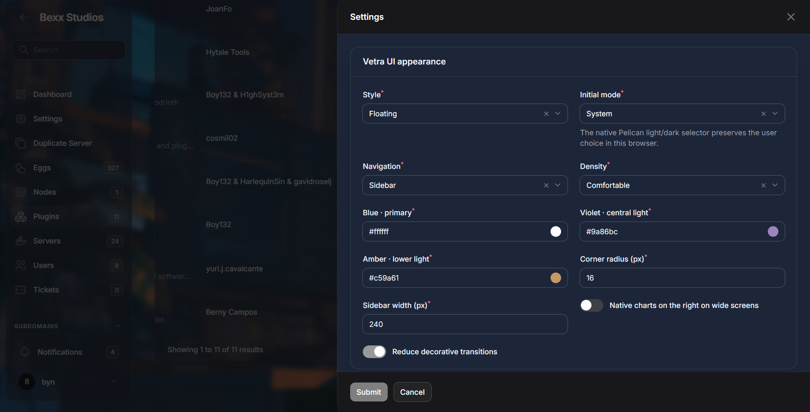
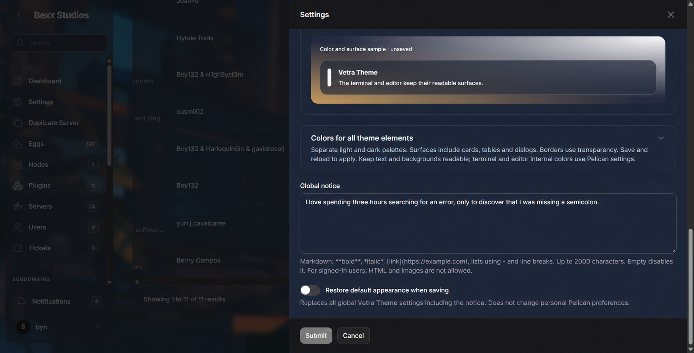
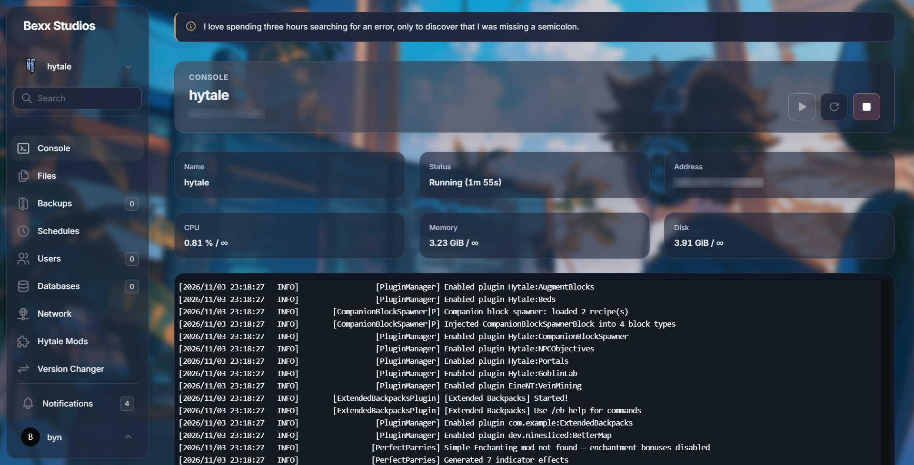
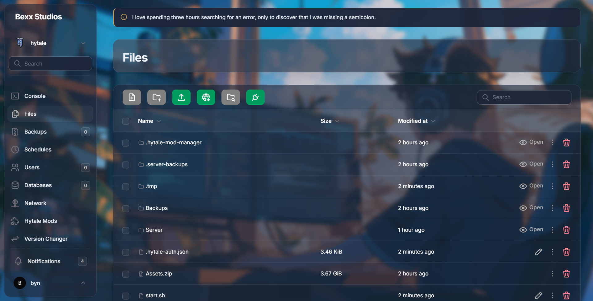

# Vetra Theme

A configurable glass theme for **Pelican Panel 1.0.0-rc.2**, packaged as a plugin with category `theme` and API version 1.

Vetra Theme adds ambient lighting, translucent surfaces, and persistent appearance controls without replacing Filament's foundational CSS, modifying Pelican core, or recreating operational features. Console access, files, metrics, permissions, and power actions remain native Pelican features.

## Highlights

- Glass, Solid, Floating, and Light Glass visual styles.
- Native sidebar, topbar, or mixed navigation where Pelican exposes those layouts.
- Separate light and dark palettes with 29 configurable colors.
- Adjustable opacity, blur, radius, density, sidebar width, and background treatment.
- Background image upload from plugin settings with validated persistent storage.
- Safe global notice with Markdown, links, lists, and responsive spacing.
- Server header, six independent resource cards, and native SVG power controls.
- Readable solid surfaces for the console and editor.
- Optional right-side layout for charts that Pelican actually renders.
- English as the source language and Spanish as a panel-locale translation.
- Reduced-motion, reduced-transparency, focus, and forced-color support.

## Screenshots

### Administration



### Appearance settings





### Server console and files





See the [screenshot guide](docs/SCREENSHOTS.md) for the purpose and limits of each image.

## Requirements

- Pelican Panel `1.0.0-rc.2`.
- PHP `8.4` or the version required by that Pelican release.
- Pelican queue worker running while installing or updating plugins.
- A browser with modern CSS support.

Compatibility is intentionally restricted to the tested release. Read [COMPATIBILITY.md](docs/COMPATIBILITY.md) before trying another version.

## Installation

1. Download `vetra-theme-1.0.1.zip` from the release assets.
2. Open **Administration → Plugins → Import**.
3. Import the ZIP and wait for the queue job to finish.
4. Install and enable Vetra Theme.
5. Open the plugin settings, save the appearance, and fully reload the page.

Do not copy files into Pelican's `app`, `resources`, `vendor`, or other core directories. The full [installation guide](docs/INSTALLATION.md) covers verification, updates, and removal.

## Configuration and localization

Settings are available at **Administration → Plugins → Vetra Theme → Settings**. They include style, navigation, density, colors, opacity, blur, radius, sidebar width, background, safe Markdown notice, and accessibility preferences.

English is the source language in code, metadata, tests, and documentation. Runtime labels use Pelican's translation system under `vetra-theme::ui`; `lang/es` supplies Spanish automatically when the panel locale is Spanish. The plugin does not force or override the user's locale.

Uploaded images are stored persistently in `storage/app/vetra-theme/background`. When possible, a mirror is kept in `plugins/vetra-theme/background`; Vetra Theme never changes server permissions. A read-only route serves the selected image with a random name and restrictive headers. Supported formats and limits are documented in [CONFIGURATION.md](docs/CONFIGURATION.md).

## Security and privacy

Vetra Theme contains no direct SQL, migrations, telemetry, analytics, obfuscated code, process execution, or hidden remote calls.

- Saving settings requires Pelican's administrative plugin-update authorization.
- Colors, numbers, paths, Markdown, and uploads are validated before use.
- Uploaded SVG files are parsed and reduced to an allowlist of safe graphical elements.
- Background filenames are random and the public route is read-only.
- The configured Pelican Hub update URL is declared explicitly in `plugin.json`.

Read [SECURITY.md](SECURITY.md) and [docs/SECURITY.md](docs/SECURITY.md) for reporting instructions and the technical security model.

## Documentation

| Guide | Contents |
| --- | --- |
| [Installation](docs/INSTALLATION.md) | Import, enable, verify, update, and remove |
| [Configuration](docs/CONFIGURATION.md) | Visual options, backgrounds, colors, and Markdown |
| [Screenshots](docs/SCREENSHOTS.md) | Visual evidence and its scope |
| [Architecture](docs/ARCHITECTURE.md) | Hooks, components, storage, and boundaries |
| [Security](docs/SECURITY.md) | Validation, attack surfaces, and privacy |
| [Compatibility](docs/COMPATIBILITY.md) | Tested versions and browser behavior |
| [Validation](docs/VALIDATION.md) | Automated checks and pending tests |
| [Troubleshooting](docs/TROUBLESHOOTING.md) | Queue, cache, uploads, and recovery |
| [Release](docs/RELEASE.md) | GitHub Releases, update feed, and Hub submission |
| [Pelican Hub listing](docs/PELICAN_HUB.md) | English Marketplace copy and screenshots |
| [Contributing](CONTRIBUTING.md) | Development rules and pull requests |

## Development

```bash
npm ci
npm run build
npm test
php tests/appearance.php
python scripts/package.py --repository BernyCampos/VetraTheme
```

CI validates the manifest, compiled assets, PHP syntax, security-focused appearance checks, documentation, and deterministic packages.

## Packages

The packaging script creates:

- `build/vetra-theme-1.0.1.zip` — installable plugin.
- `build/vetra-theme-1.0.1-source.zip` — source, tests, and workflow.
- `build/SHA256SUMS` — release checksums.
- `build/update.json` — update feed when `--repository` is provided.

The installable ZIP contains one `vetra-theme/` root, `plugin.json` without `meta`, compiled assets, documentation, and the license. It excludes development dependencies, secrets, test sessions, and user-uploaded backgrounds.

## License

[GNU General Public License v3.0 only](LICENSE). Copyright © 2026 Berny Campos.
