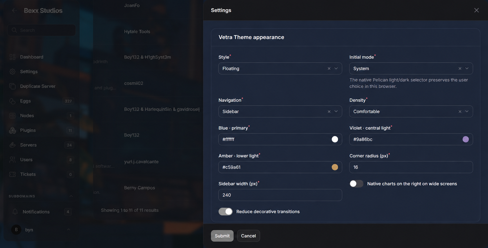
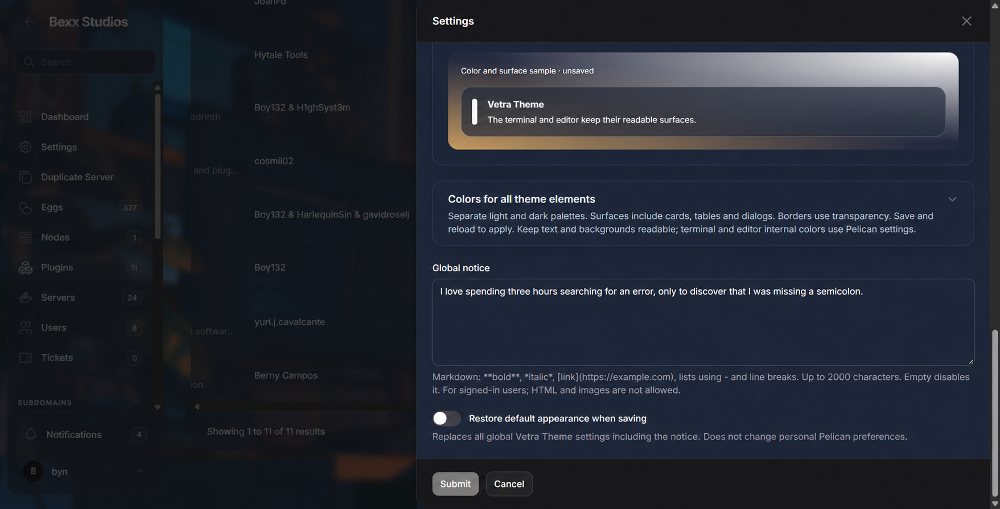

# Configuration

Open **Administration → Plugins → Vetra Theme → Settings**. Changes are global and require administrative permission to update the plugin.



## Appearance

| Field | Options or range | Purpose |
| --- | --- | --- |
| Style | Glass, Solid, Floating, Light Glass | Surface transparency and navigation treatment |
| Initial mode | System, Light, Dark | Initial value; Pelican's user selector keeps the browser choice |
| Navigation | Pelican preference, Sidebar, Topbar, Mixed | Uses native components available in each panel |
| Density | Comfortable, Compact | Table and header spacing |
| Primary | Six-digit hex color | Buttons and upper/right ambient light |
| Secondary | Six-digit hex color | Central ambient light |
| Accent | Six-digit hex color | Lower/left ambient light |
| Surface opacity | 65–100% | Card and navigation transparency |
| Navigation blur | 0–40 px | Sidebar and topbar backdrop blur |
| Corner radius | 8–28 px | Shared rounded corners |
| Sidebar width | 220–320 px | Native sidebar width |
| Native charts on right | On/off | Reflows existing charts at widths of 1280 px or greater |
| Reduce transitions | On/off | Disables decorative motion |

The `app` panel never receives an invented sidebar. Navigation settings apply only where Pelican exposes the corresponding native component.

## Full palettes

Expand **Colors for all theme elements** to edit separate light and dark values for page, surface, sidebar, topbar, primary text, secondary text, border, global notice, notice accent, form inputs, and console frame. Status colors control success, warning, danger, and information elements.

All colors must be six-digit hexadecimal values. Invalid values fall back to safe defaults and strings capable of CSS injection are rejected.

## Background images

Upload through **Upload background image** and save. The selected file is validated before it becomes persistent.

| Format | Handling |
| --- | --- |
| JPEG, PNG | Original validated bytes preserved |
| WebP, GIF | Original validated bytes preserved; animated GIF remains animated |
| AVIF, BMP, ICO | Original validated bytes preserved when PHP recognizes the content |
| SVG | Parsed and rebuilt from a strict graphical allowlist |

Limits are 5 MB and 8192 × 8192 pixels for raster images. Convert HEIC, TIFF, and PSD first. A valid upload is stored in `storage/app/vetra-theme/background` and exposed as `/vetra-theme/background/<random-name>`. The optional path field accepts only safe absolute local image paths; remote URLs, query strings, traversal, and direct SVG paths are rejected.

**Remove the background when saving** clears the selected image and returns to ambient colors. Previous files remain in storage to avoid destructive data loss.

## Safe global notice



The notice accepts up to 2,000 characters of Markdown. Supported output includes headings, bold, italic, strike-through, lists, quotes, code, line breaks, and `https`, `http`, or `mailto` links.

Raw HTML, images, styles, event attributes, scripts, embedded content, and unsafe URL schemes are removed. The notice appears only to authenticated panel users. Empty content disables it. The notice has a responsive gap below the topbar so it does not touch navigation.

Example:

```markdown
## Scheduled maintenance

- Starts at **22:00 UTC**
- Follow [service status](https://example.com/status)
```

The environment value `VETRA_THEME_NOTICE_MARKDOWN` uses base64 to keep multiline text on one line. Do not place secrets in a notice.

## Reset

Enable **Restore default appearance when saving** and submit. This restores all global Vetra Theme values, including the notice. It does not alter personal Pelican theme preferences and it does not delete uploaded files.

## Locale behavior

English (`lang/en`) is the source UI. Spanish (`lang/es`) is loaded automatically through Pelican's plugin translation namespace when the panel locale is Spanish. Vetra Theme does not set, store, or override the panel locale.
