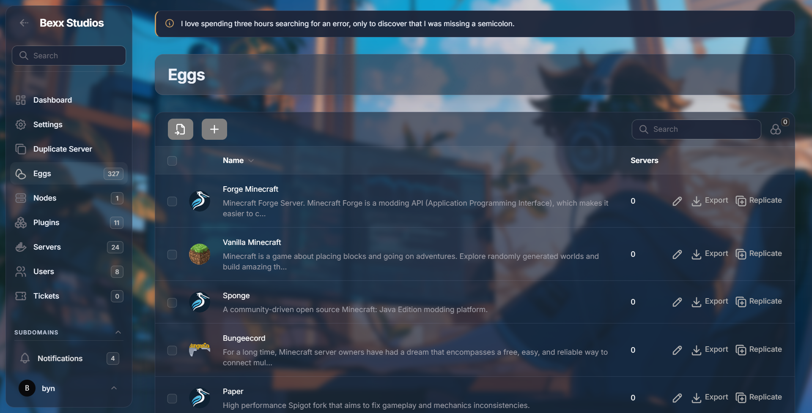
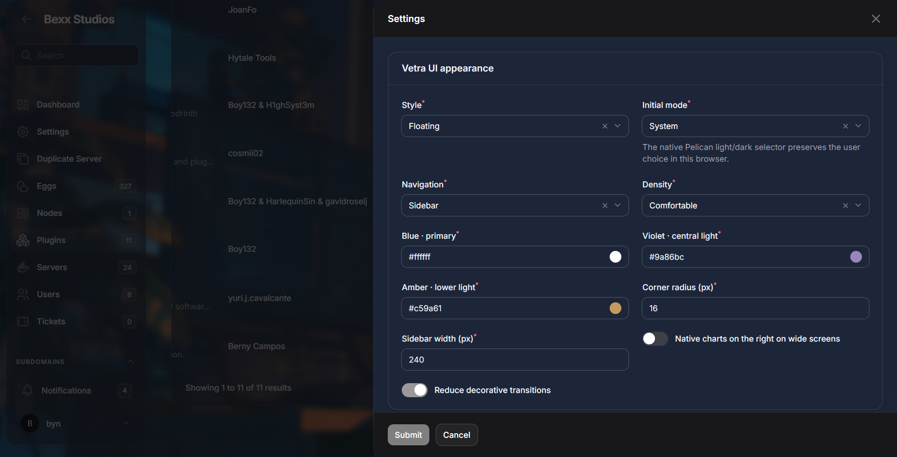
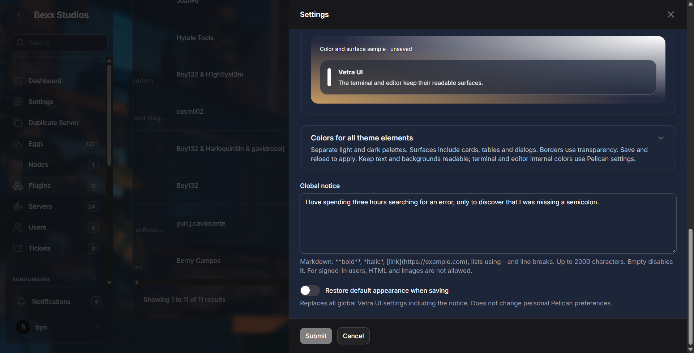
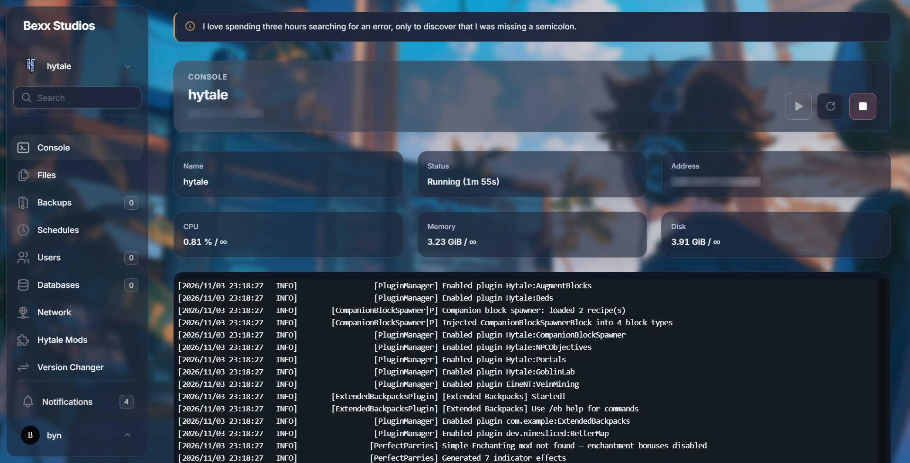
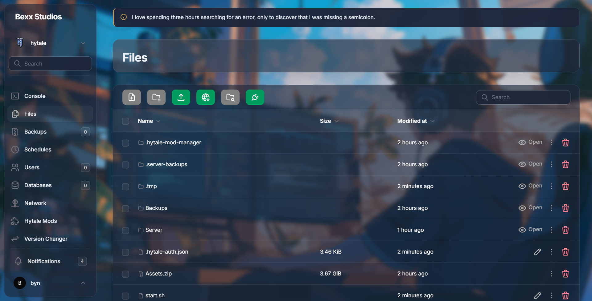

# Capturas

Las capturas documentan VetraTheme ejecutándose sobre Pelican Panel. Los servidores, archivos, métricas, nombres, plugins y acciones que aparecen pertenecen a la instalación capturada; Vetra únicamente modifica la presentación.

## Administración

Demuestra navegación administrativa, aviso global, cabecera, tabla, búsqueda, acciones e integración del fondo Glass.

## Ajustes principales

Demuestra estilo Floating, modo inicial, navegación, densidad, colores ambientales, radio, ancho lateral y preferencias de movimiento/gráficos.

## Paletas y aviso

Demuestra la vista previa, la sección de paletas, el editor del aviso Markdown y la restauración de valores.

## Consola

Demuestra cabecera del servidor, botones de energía con SVG nativos, seis recursos independientes, consola legible y navegación del panel `server`.

## Gestor de archivos

Demuestra barra de acciones, búsqueda, tabla, iconos y acciones nativas sobre una superficie translúcida.

## Alcance

Estas imágenes son evidencia visual, no una certificación de todas las operaciones de Wings. La validación automatizada y las pruebas pendientes se detallan en [VALIDATION.md](VALIDATION.md).
